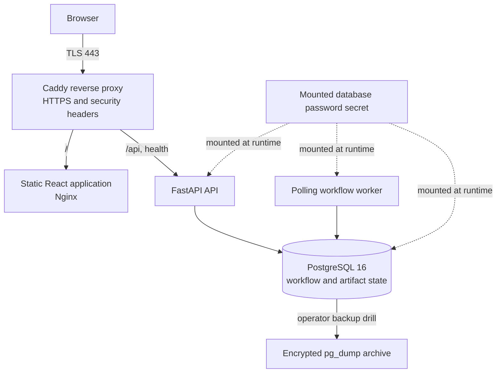

# ORQESTRA AI deployment architecture

The production Compose overlay publishes only Caddy on ports 80 and 443. The frontend and API are internal Compose services; PostgreSQL has no host port mapping. Caddy terminates TLS and forwards `/api/*` plus the health routes to FastAPI. The single VPS model assumes host firewall rules restrict SSH to operator addresses and permit inbound web traffic only on 80/443.

The backend stores workflows, events, approvals, documents, research provenance, generated artifacts, and atomic login-attempt windows in PostgreSQL. A separate polling worker claims ready tasks from PostgreSQL and publishes results while it owns a live lease.

The optional code sandbox must use a separate, dedicated Docker Engine over TLS. The production profile leaves it disabled. Do not mount the production host Docker socket into the API.
